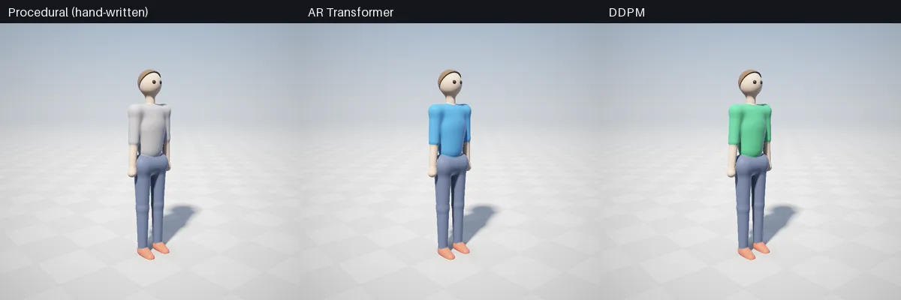
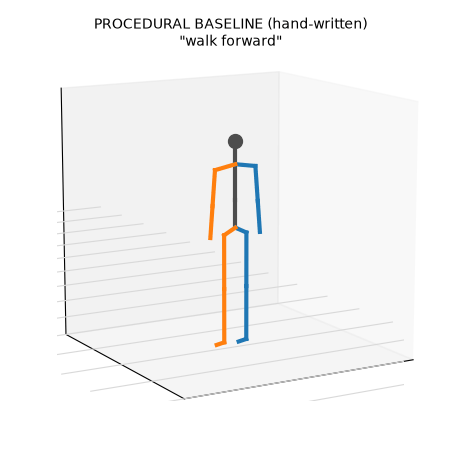
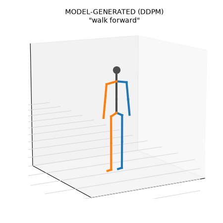
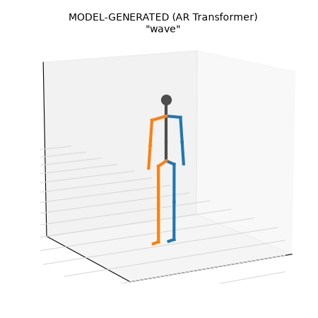
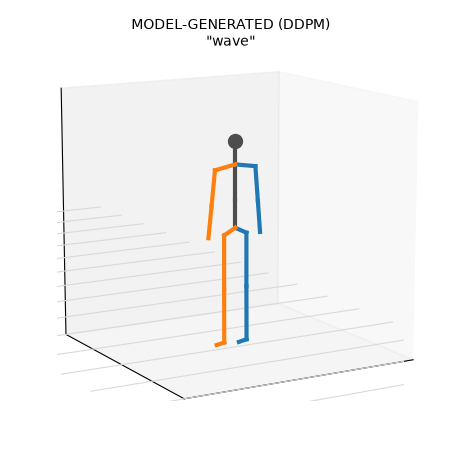
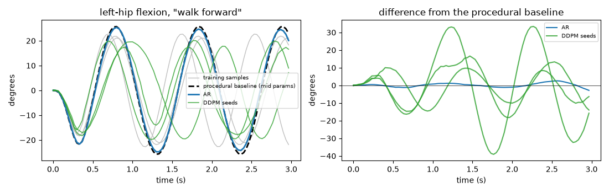
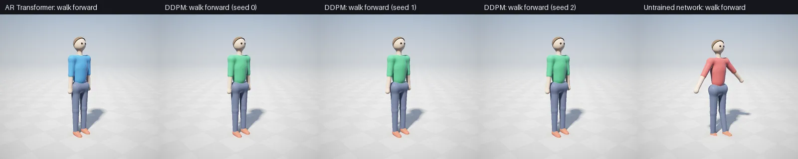
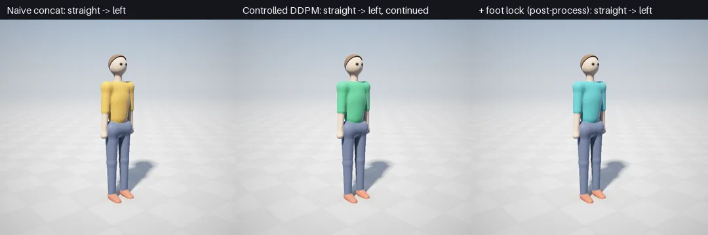
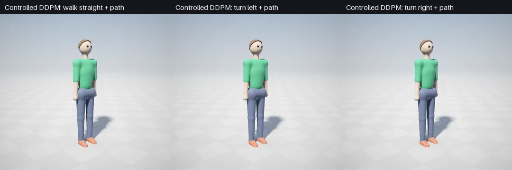
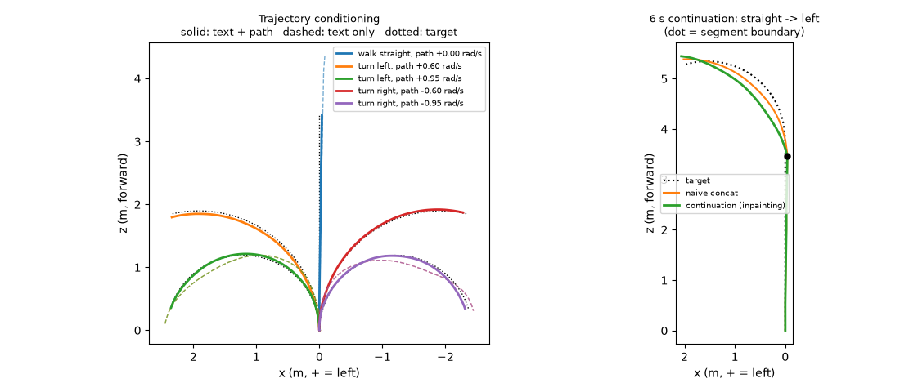

# Text → 3D Stick-Figure Animation

A minimal text-to-motion prototype: an instruction such as *"walk forward"*, *"wave"* or *"raise both arms"* becomes a 3 s animation of an 18-joint 3D skeleton. It reuses three ideas from Vibe-CADing: a **structured 3D representation** (a joint hierarchy and forward kinematics, in place of B-rep or SDF code), **autoregressive generation** (as in the PixelCNN CAD grids), and **language conditioning**. It adds a **diffusion** model alongside the autoregressive one.

**Game-style render** ([render_character.py](render_character.py)): the same clips drawn as a stylized character. Shirt colour marks the source: grey = procedural, blue = AR, green = DDPM.





**Stick-figure render** ([visualize.py](visualize.py)):

| Procedural baseline (hand-written) | AR Transformer (learned) | DDPM (learned) |
|---|---|---|
|  |  |  |
|  |  |  |

`raise_arms_*` and single-clip game renders are written to `outputs/` and `outputs/game/` when you run the scripts (not tracked in git).

The game render changes **only the look**: the joint positions are exactly the ones in the stick-figure GIFs and the metrics below. A body around the skeleton makes motion flaws easier to see, for example foot sliding in the walk.

### Why do the AR and DDPM clips look like the baseline?

The procedural baseline uses the **mid-range** parameters, which is the mean of the training distribution. A deterministic AR model trained with MSE learns exactly that mean, so its walk stays within 3° of the baseline. DDPM samples are spread over the training range (period, amplitude, distance). [diagnostics.py](diagnostics.py) makes this visible:




An **untrained** network run through the same code path (red) produces no recognizable motion. Swapping the text ("wave hello", "arms up") changes the output of both trained models accordingly. The resemblance to the baseline means the models learned the data, not that the code copied it.

> **Procedural vs. generated.** `*_procedural` clips come from hand-written sine-based formulas ([motions.py](motions.py)); no learning is involved. `*_ar` and `*_diffusion` clips are generated by the trained networks from the text alone. Both networks were trained on **600 randomized procedural clips covering 3 commands**, so they learn to reproduce that small distribution. Nothing here shows generalization to new motions or new phrasings.

## Run

```bash
pip install torch numpy matplotlib pillow moderngl
python generate_motion.py                        # train both models (~1 min on GPU, a few min on CPU), evaluate, write outputs/
python visualize.py outputs/*.npz                # -> outputs/*.gif   (--show for a window)
python render_character.py outputs/*.npz --compare   # -> outputs/game/*.webp  (needs moderngl + OpenGL 3.3; ~40 s on GPU)
python diagnostics.py && python render_character.py --grid outputs/diagnostics/*.npz --out walk_seeds_untrained
python generate_motion.py --text "wave hello"    # one clip from the saved models
python generate_motion.py --method diffusion --retrain --steps 8000
python control.py                                # controllable DDPM: train (~1 min GPU), evaluate -> outputs/control/
python render_character.py --grid outputs/control/continuous_*.npz --out continuous_walk
python render_character.py --grid outputs/control/traj_straight.npz outputs/control/traj_left.npz outputs/control/traj_right.npz --out trajectory_compare
```

The vocabulary is the 10 training phrases ([motions.py](motions.py) `COMMANDS`). Unknown words are dropped, and a text with no known words is rejected.

## Files

| File | Role |
|---|---|
| [skeleton.py](skeleton.py) | 18-joint hierarchy, Euler rotations, forward kinematics |
| [motions.py](motions.py) | procedural baseline and training data, feature encoding |
| [model.py](model.py) | autoregressive Transformer, word vocabulary |
| [diffusion.py](diffusion.py) | DDPM: 1D temporal U-Net, cosine schedule, classifier-free guidance |
| [metrics.py](metrics.py) | jerk, foot sliding, MPJPE, diversity, rule-based instruction check |
| [generate_motion.py](generate_motion.py) | training, generation, evaluation (`outputs/metrics.json`) |
| [visualize.py](visualize.py) | animated 3D skeleton → GIF (Matplotlib) |
| [diagnostics.py](diagnostics.py) | hip-angle curves (baseline vs AR vs DDPM seeds), untrained-network control |
| [control.py](control.py) | controllable DDPM: past-frame and root-path conditioning, segment continuation, foot-lock post-process, metrics |
| [render_character.py](render_character.py) | game-style character → animated WebP. The body is an SDF of tapered capsules and ellipsoids between the FK joints, smooth-blended per material and sphere-traced on the GPU (the same technique as [../CAD_Harness/sdf](../CAD_Harness/sdf/)), with soft shadows, AO, rim light and a follow camera |

## Formulation

**Skeleton and FK.** Joint $j$ has a parent $\pi(j)$, a rest offset $o_j$ and a local rotation $R(\theta_j)$, with $\theta$ given as XYZ Euler angles. Global rotations and positions are:

$$G_j = G_{\pi(j)}\,R(\theta_j), \qquad p_j = p_{\pi(j)} + G_{\pi(j)}\,o_j,$$

with $p_{\text{root}}$ the pelvis position.

**Frame features.** $x_t = [v_x,\ y,\ v_z,\ \theta_1 \dots \theta_J] \in \mathbb{R}^{57}$. Root motion is stored as horizontal velocity (translation-invariant) plus height, and the positions are recovered by integrating the velocity. Only the 14 dimensions that vary in the training data are modelled; the rest are fixed at their constant value. A clip is $X = x_{1:T}$, with $T = 90$ frames at 30 fps.

**Instruction embedding.** $c$ is the mean of the learned word embeddings of the instruction (`EmbeddingBag`).

**AR Transformer** ([model.py](model.py), 0.6 M params). The sequence is the token $c$ followed by one token per frame, with causal self-attention (3 layers, $d = 128$):

$$p(X \mid c) = \prod_t p(x_t \mid x_{<t}, c), \qquad p(x_t \mid x_{<t}, c) = \mathcal{N}\big(f_\theta(x_{<t}, c),\, I\big) \;\Rightarrow\; \mathcal{L} = \lVert x_t - f_\theta(x_{<t}, c) \rVert^2$$

Training uses teacher forcing, with Gaussian noise ($\sigma = 0.05$) added to the input frames so rollouts can recover from their own errors. Generation is deterministic: one motion per text.

**DDPM** ([diffusion.py](diffusion.py), 1.1 M params). The model denoises the **whole clip at once**:

$$X_k = \sqrt{\bar\alpha_k}\,X_0 + \sqrt{1-\bar\alpha_k}\,\epsilon, \qquad \epsilon \sim \mathcal{N}(0, I), \qquad \text{cosine schedule},\ K = 100$$

$$\mathcal{L} = \lVert X_0 - G_\theta(X_k, k, c) \rVert^2$$

The model predicts $X_0$ (as in MDM), which made motion much smoother than predicting $\epsilon$. Sampling starts from $X_K \sim \mathcal{N}(0, I)$ and draws $X_{k-1} \sim q(X_{k-1} \mid X_k, \hat X_0)$ down to $X_0$.

$G_\theta$ is a 1D U-Net over time: features are the channels, with one down/up level and FiLM conditioning on $(k, c)$. The text is dropped 10% of the time during training to enable classifier-free guidance, with $w = 2$:

$$\hat X_0 = G(\cdot, \varnothing) + w\,\big(G(\cdot, c) - G(\cdot, \varnothing)\big)$$

The saved weights are an EMA (0.999).

## Results

The table below is from one run (`outputs/metrics.json`, RTX 3090, seed 0).

| Command | Source | Follows instruction | Jerk (m/s³) ↓ | Foot sliding (m/s) ↓ | MPJPE to baseline (m) | Diversity (m) |
|---|---|---|---|---|---|---|
| walk | procedural | ✓ | 52.4 | 1.35 | – | 0 |
| walk | AR | 4/4 phrases | 86.2 | 1.34 | 0.034 | 0 |
| walk | DDPM | 4/4 | 188.5 | 1.27 | 0.270 | 0.060 |
| wave | procedural | ✓ | 13.4 | 0.00 | – | 0 |
| wave | AR | 3/3 | 54.8 | 0.02 | 0.004 | 0 |
| wave | DDPM | 3/3 | 100.7 | 0.02 | 0.009 | 0.006 |
| raise arms | procedural | ✓ | 2.6 | 0.00 | – | 0 |
| raise arms | AR | 3/3 | 34.1 | 0.02 | 0.002 | 0 |
| raise arms | DDPM | 3/3 | 97.6 | 0.01 | 0.023 | 0.026 |

| | Latency per 90-frame clip (CPU / GPU) | Training time (GPU) |
|---|---|---|
| AR (90 sequential steps, no KV cache) | 69 ms / 48 ms | 18 s |
| DDPM (100 denoising steps × 2 for guidance) | 206 ms / 89 ms | 49 s |

**Metric definitions**
- **Follows instruction:** a rule-based check on FK joint positions: walk = pelvis moves forward more than 0.8 m and the feet alternate; wave = right wrist above the head and oscillating; raise arms = both wrists above the head. It is 100% on 300 randomized procedural clips. It is a sanity check, not a learned motion classifier.
- **Jerk:** mean |d³p/dt³| over all joints. Third differences amplify noise, so even a few millimetres of frame-to-frame jitter show up strongly.
- **Foot sliding:** mean horizontal toe speed while the toe is below 2 cm. The procedural walk itself slides (1.35 m/s) because its feet are not planted. Both models copy that flaw, which makes this metric the obvious target for a physics loss.
- **MPJPE to baseline:** distance to the procedural clip with mid-range parameters, i.e. how close each model stays to the "average" training motion.
- **Diversity:** mean pairwise MPJPE between 4 samples of the same text.

**Takeaways**
- Both models follow all 10 training phrases.
- The AR model is smoother and closer to the mean motion, but it is deterministic.
- The DDPM produces different samples from different seeds (diversity > 0), at the cost of extra jitter, which is clearest for walking, and about 2× latency.
- During development, the main fixes were:
  - modelling only the moving degrees of freedom, which cut AR jerk by about 4×;
  - predicting $X_0$ instead of $\epsilon$, which cut DDPM jerk by 10× or more;
  - EMA weights for the DDPM.

**Limitations.** The data is synthetic and has 3 motions. The vocabulary is closed. Clips have a fixed 3 s length. There is no physics, so feet slide and can dip about 5 cm below the floor in the procedural walk. Euler angles can gimbal-lock.

## Controllable, continuous walking

[control.py](control.py) trains a **second** DDPM (`outputs/control.pt`). The models and results above are unchanged. It reuses `MotionDenoiser` and adds per-frame condition channels at the input:

$$\text{cond}_t = \big[\, m_t\, x_t^{\text{known}},\ m_t,\ h\, p_t,\ h \,\big]$$

- $m_t = 1$ for frames given in advance (the end of the previous segment), and $x^{\text{known}}$ holds those frames.
- $p_t$ is the target root path $(x, z)$, and $h = 1$ when a path is given.

**Training data.** 600 procedural walks of 192 frames with random turn rates (straight, left 0.5–1.0 rad/s, right −1.0 to −0.5 rad/s), cut into 3,600 windows of 96 frames at random offsets. Each window is expressed in the frame of its first pose (root at the origin, heading +Z), so "continue from mid-stride" is in the training distribution.

**Training conditions.** In each batch, half the windows get a known prefix of 8–16 frames, and 80% get the path. Text is dropped 10% of the time for guidance, as before. Training takes 8,000 steps (66 s on the GPU).

**Continuation** is learned: the model sees the past frames as input. The 12 carried-over frames are also enforced by inpainting during sampling, so the joints at the boundary match exactly. Each segment is generated in its own local frame and moved back to world coordinates.

**Foot lock is a post-process, not learned.** It detects planted toes (the slower toe, on the ground, under 1 m/s), pins them, and re-solves the knee with two-bone IK. The root path is untouched.





**Trajectory conditioning** (same text, different target paths; mean root distance to the target, 3 seeds; written to `outputs/control/metrics.json`):

| Text | Target turn rate | Error with text + path | Error with text only |
|---|---|---|---|
| walk straight | 0 | **0.018 m** | 0.296 m |
| turn left | +0.60 rad/s | **0.040 m** | 0.557 m |
| turn left | +0.95 rad/s | **0.037 m** | 0.368 m |
| turn right | −0.60 rad/s | **0.035 m** | 0.621 m |
| turn right | −0.95 rad/s | **0.040 m** | 0.335 m |

The path channel controls how sharply the character turns, beyond what the text alone sets, so the conditioning is real: the character is not rotated after generation.

**6 s continuation:** "walk straight" (96 frames from rest), then "turn left" (84 new frames generated from the last 12). The naive baseline uses the same model without the past frames and is placed at the end position and heading of segment 1.

| | Joint jump at boundary | Accel. spike at boundary | Heading step at boundary | Stance foot sliding | Path error |
|---|---|---|---|---|---|
| naive concatenation | 0.107 m (2.7× a normal step) | 125 m/s² | 3.6° | 0.49 m/s | 0.055 m |
| **continuation** | **0.041 m** (normal step: 0.039) | **20 m/s²** | 4.6° | 0.42 m/s | 0.097 m |
| continuation + foot lock | 0.041 m | 20 m/s² | 4.6° | **0.16 m/s** | 0.097 m |

The median acceleration over the clip is about 5 m/s². Latency is 90 ms per 96-frame segment on the RTX 3090 (100 denoising steps × 2 for guidance).

**What works:**
- With past-frame conditioning, the boundary is indistinguishable from a normal frame step.
- The path channel steers the walk to within about 4 cm.
- Foot locking cuts stance sliding by about 60% without changing the path.

**What remains:**
- There is a ~3° heading kink at the boundary where the turn starts. The target turn rate is about 1.4° per frame.
- Continuation follows the path slightly worse than naive concatenation (0.10 vs 0.06 m), because it has to start from where segment 1 actually ended.
- The foot lock is post-processing. A physics-informed version would put a contact loss on $\hat X_0$ during training.
- The procedural walk barely lifts its feet, so the original foot-sliding metric (any toe below 2 cm) is dominated by swing frames. "Stance sliding" scores only the planted toe.
- Everything is trained on synthetic walks: three turn regimes at one speed range.

## Next steps the structure supports

- **VQ-VAE motion tokens:** encode clips into discrete tokens and swap the AR `head` for token logits, giving a PixelCNN/GPT-style sampler with real diversity.
- **Better diffusion:** add a Transformer denoiser, longer training, and inpainting (fix keyframes during sampling) for in-betweening.
- **Contrastive text–motion embeddings:** a CLIP-style loss between `EmbeddingBag` text features and motion encodings, for retrieval and for a learned instruction-following score.
- **Physics-informed losses:** because the DDPM predicts $\hat X_0$, a foot-contact loss $\lVert v_{\text{foot}} \rVert^2\,\mathbb{1}[\text{contact}]$, a ground-penetration loss $\max(0, -y_{\text{foot}})^2$ or a velocity loss can be applied through FK directly in training.
- **Real data:** swap `procedural_motion` for AMASS or HumanML3D clips retargeted to this skeleton.

## Relation to the research directions

- **Motion generation:** two standard generative families (autoregressive likelihood and denoising diffusion) trained on the same representation and compared with the same metrics.
- **Controllable character animation:** text controls the motion through prefix-token and FiLM conditioning. Classifier-free guidance (w) trades how strongly the text is followed against diversity. Diffusion inpainting would add keyframe control.
- **Data-efficient learning:** each model learns from 600 cheap synthetic clips in under a minute, because the skeleton prior (FK, the joint hierarchy, keeping only the moving degrees of freedom) does much of the work. Pre-training on procedural data and then fine-tuning on a few real clips is the natural next experiment.
- **Physics:** foot sliding and ground penetration are already measured. Adding them as losses is the next step.
- **Automating repetitive tasks:** in-betweening and "make a walk cycle" are routine animator work. Text plus keyframe-conditioned generation targets exactly that.
