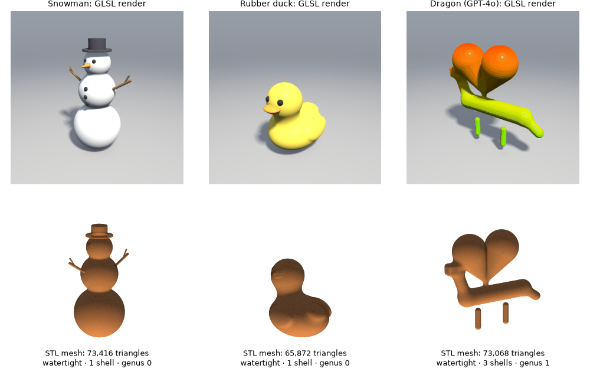
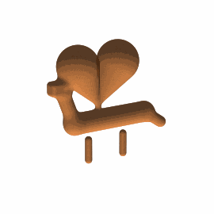
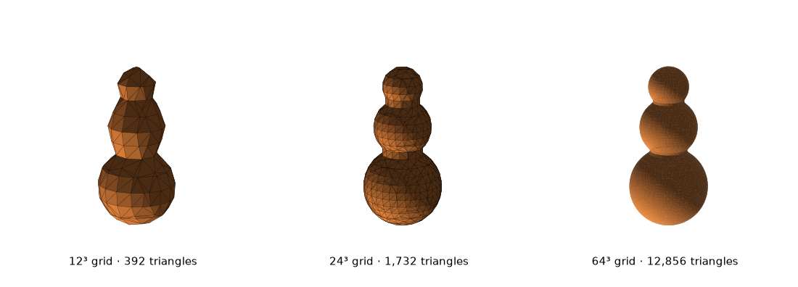
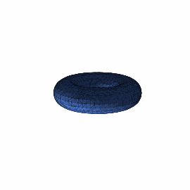

# Geometry engine (C++)

Turns a signed distance function (SDF) into a **3D-printable triangle mesh**:

```
SDF  →  sample on a 3D grid  →  marching cubes  →  check mesh  →  STL file
```

The SDF harness (`../CAD_Harness/sdf`) produces shapes as GLSL code that can
only be *rendered*. This module makes them *real geometry*: a closed mesh you
can open in MeshLab, Blender or a 3D-printer slicer.

## From LLM shapes to STL

Any GLSL shape from the SDF harness, including LLM-written ones, becomes a
printable mesh: the GPU samples its `sdf()` on a grid, and this engine meshes it.



```bash
pip install ./src/geometry_engine                  # builds the C++ module (from the repo root)
cd src/CAD_Harness/sdf
python demo.py --example dragon_gpt4o --stl        # → results/dragon_gpt4o.stl
python to_stl.py examples/duck.glsl duck.stl       # any .glsl file directly
```

```
results/dragon_gpt4o.stl: 36,538 vertices, 73,068 triangles (160^3 grid; GPU sampling 227 ms, C++ meshing 35 ms)
  size 99.0 x 30.0 x 88.2 mm | volume 51406.3 mm^3 | watertight yes | shells 3 | genus 1
```

The STL is Z-up, in millimetres (1 SDF unit = 50 mm) and sits on the build plate,
so it opens directly in a slicer. The checks also catch design flaws a render
hides: the GPT-4o dragon has **3 shells**, because its legs float below the body.



## Demo

The same snowman SDF meshed at three grid resolutions: more cells, more triangles, smoother surface.



| Snowman, 24³ (1,732 triangles) | Torus, 32³ (3,120 triangles, genus 1) |
|---|---|
|  |  |

Re-create these: run `mc_demo` for `snowman` at 12, 24 and 64 and `torus` at 32
(output to `build/<shape>_<n>.stl`), then `python bench/render_demo.py`.

## How it works

1. **Sample**: evaluate `sdf(x, y, z)` at every point of an `(n+1)³` grid over `[-1, 1]³`.
2. **Marching cubes**: for each grid cell, the 8 corner signs (inside < 0) form an
   8-bit case number. A 256-entry table (`mc_tables.hpp`) says which cell edges the
   surface crosses and how to connect them into triangles. Each crossing point is
   linearly interpolated, and shared between neighbouring cells so the mesh has no cracks.
3. **Check**: volume, surface area, watertight (every edge shared by exactly 2
   triangles), consistent orientation, number of shells, genus (holes).
4. **Export**: binary STL.

## Why C++?

Marching cubes is millions of tiny steps: read 8 numbers, look up a table, emit
a few triangles. In Python every step goes through the interpreter; in C++
it compiles to a few machine instructions.

Same algorithm, same snowman, same output (identical vertex and triangle counts).
C++ on **one** thread vs pure Python (`bench/mc_python.py`):

| Grid | Step | Pure Python | C++ | Speed-up |
|---|---|---|---|---|
| 64³ | sample SDF | 423 ms | 5.9 ms | **72×** |
| 64³ | marching cubes | 483 ms | 4.2 ms | **115×** |
| 128³ | sample SDF | 3,336 ms | 38 ms | **88×** |
| 128³ | marching cubes | 3,693 ms | 16 ms | **228×** |

With OpenMP on all cores, sampling at 256³ drops from 227 ms to 43 ms. Memory is
compact too: the grid is one flat `float` array and the mesh shares vertices
(vs. Python objects at ~30+ bytes per number).

NumPy or scikit-image would also be fast, because they're compiled C under the hood.
Owning the C++ lets us add mesh repair, validation and export in the same fast
layer, and later call it from Python with pybind11.

## Build and run

```bash
cd src/geometry_engine
cmake -B build            # if cmake is missing: pip install cmake
cmake --build build -j
./build/mc_demo snowman 128 snowman.stl     # sphere | torus | snowman
./build/test_mc                              # correctness tests
python bench/mc_python.py 64                 # Python baseline
```

Example output:
```
snowman  128^3 cells  ->  25642 vertices, 51280 triangles
time: sample 37.9 ms | marching cubes 16.2 ms | checks 18.1 ms
volume 0.5781 | area 4.1425 | watertight yes | oriented yes | shells 1 | genus 0
```

## Python module

`pip install ./src/geometry_engine` builds `vibecad_geom` (pybind11; NumPy in, NumPy out):

```python
import vibecad_geom as g
vertices, triangles = g.marching_cubes(values, lo=-1, hi=1)   # values: (m, m, m) float32, [z, y, x]
g.analyze(vertices, triangles)    # {'volume', 'area', 'watertight', 'oriented', 'components', 'genus', ...}
g.write_stl(vertices, triangles, "shape.stl")
```

Meshing releases the Python GIL, so it can run alongside other Python threads.

## How we know it's correct

`tests/test_mc.cpp` checks:
- sphere and torus volume/area against the exact formulas (within 1–2%)
- genus: sphere 0, torus 1; two separate spheres give 2 shells
- ~20,000 random grids that hit all 256 cube cases, all closed and consistently oriented
- `tests/test_bindings.py`: the Python module (volume, genus, STL size, bad input)
- `../CAD_Harness/sdf/test_harness.py`: GPU sampling matches the exact SDF, `to_stl.py` and `demo.py --stl`

## Files

| File | Purpose |
|---|---|
| `include/vibecad/mesh.hpp` | `Grid`, `Mesh`, `sample()`, API |
| `include/vibecad/mc_tables.hpp` | marching-cubes lookup table (Paul Bourke, public domain) |
| `include/vibecad/shapes.hpp` | sphere, torus, smooth union, snowman |
| `src/marching_cubes.cpp` | grid → indexed mesh |
| `src/mesh_stats.cpp` | volume, area, watertight, genus |
| `src/stl.cpp` | binary STL writer |
| `src/mc_demo.cpp` | command-line demo |
| `src/bindings.cpp` | pybind11 module `vibecad_geom` |
| `pyproject.toml` | `pip install` build (scikit-build-core) |
| `../CAD_Harness/sdf/to_stl.py` | GLSL → GPU grid → this engine → STL |
| `bench/mc_python.py` | pure-Python twin for speed comparison |
| `bench/render_demo.py` | renders the demo images in `assets/` (`glsl` arg: GLSL → mesh figure) |

## Next steps

- ~~pybind11 bindings so `demo.py` can turn LLM shapes into STL files~~ done
- ~~sample the GLSL `sdf()` on the GPU and pass the grid to C++~~ done
- mesh smoothing, simplification, OBJ export
- use shells / genus as automatic feedback to the LLM ("your legs are not attached")
