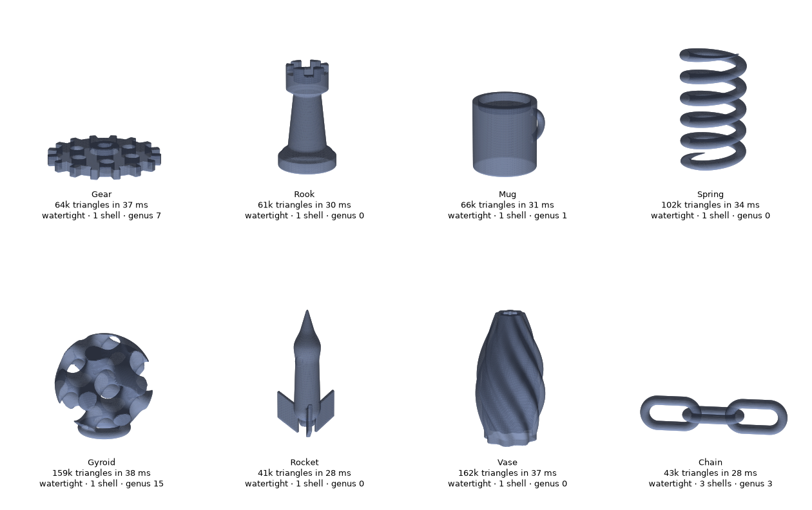
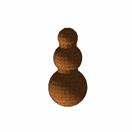

# Geometry engine (C++)

Turns a signed distance function (SDF) into a **3D-printable triangle mesh**:

```
SDF  →  sample on a 3D grid  →  marching cubes  →  check mesh  →  STL file
```

The SDF harness (`../CAD_Harness/sdf`) produces shapes as GLSL code that can
only be *rendered*. This module makes them *real geometry*: a closed mesh you
can open in MeshLab, Blender or a 3D-printer slicer.

## From LLM shapes to STL

Any GLSL shape from the SDF harness, including LLM-written ones, becomes a
printable mesh: the GPU samples its `sdf()` on a grid, and this engine meshes it.


```bash
pip install ./src/geometry_engine                  # builds the C++ module (from the repo root)
cd src/CAD_Harness/sdf
python demo.py --example dragon_gpt4o --stl        # → results/dragon_gpt4o.stl
python to_stl.py examples/duck.glsl duck.stl       # any .glsl file directly
```

```
results/dragon_gpt4o.stl: 36,538 vertices, 73,068 triangles (160^3 grid; GPU sampling 227 ms, C++ meshing 35 ms)
  size 99.0 x 30.0 x 88.2 mm | volume 51406.3 mm^3 | watertight yes | shells 3 | genus 1
```

The STL is Z-up, in millimetres (1 SDF unit = 50 mm) and sits on the build plate,
so it opens directly in a slicer. The checks also catch design flaws a render
hides: the GPT-4o dragon has **3 shells**, because its legs float below the body.


## Text-to-CAD gallery: the meshes

Eight text prompts (from the [SDF gallery](../CAD_Harness/sdf/README.md#text-to-cad-gallery)),
each turned into GLSL by an LLM and then meshed by this engine at 160³. These are the
real STL meshes, with the checks the engine reports:



| Shape | Check | Why it matters |
|---|---|---|
| Gear | genus 7 | exactly the 6 lightening holes + the bore the prompt asked for |
| Chain | 3 shells, genus 3 | three separate interlocked rings; all touch the plate, so it prints in one go |
| Gyroid | 1 shell, genus 10 | one connected lattice; earlier versions had **19**, then **6** loose fragments, invisible in the render |
| Mug | 1 shell, genus 1 | the handle; an earlier version's coffee floated as a 2nd shell |

Each mesh takes 30–40 ms in C++. Resolution matters for topology: at 128³ the
chain's 0.02-unit gap between links is smaller than a grid cell, so they fuse into
1 shell. Thin features need a finer grid.

```bash
cd src/CAD_Harness/sdf && python gallery.py           # all 8: render + STL + checks
cd src/geometry_engine && python bench/render_demo.py gallery   # this figure
```

## Demo

The same snowman SDF meshed at three grid resolutions: more cells, more triangles, smoother surface.


| Snowman, 24³ (1,732 triangles) | Torus, 32³ (3,120 triangles, genus 1) |
|---|---|
|  |  |

Re-create these: run `mc_demo` for `snowman` at 12, 24 and 64 and `torus` at 32
(output to `build/<shape>_<n>.stl`), then `python bench/render_demo.py`.

## How it works

1. **Sample**: evaluate `sdf(x, y, z)` at every point of an `(n+1)³` grid over `[-1, 1]³`.
2. **Marching cubes**: for each grid cell, the 8 corner signs (inside < 0) form an
   8-bit case number. A 256-entry table (`mc_tables.hpp`) says which cell edges the
   surface crosses and how to connect them into triangles. Each crossing point is
   linearly interpolated, and shared between neighbouring cells so the mesh has no cracks.
3. **Check**: volume, surface area, watertight (every edge shared by exactly 2
   triangles), consistent orientation, number of shells, genus (holes).
4. **Export**: binary STL.

## Why C++?

Marching cubes is millions of tiny steps: read 8 numbers, look up a table, emit
a few triangles. In Python every step goes through the interpreter; in C++
it compiles to a few machine instructions.

Same algorithm, same snowman, same output (identical vertex and triangle counts).
C++ on **one** thread vs pure Python (`bench/mc_python.py`):

| Grid | Step | Pure Python | C++ | Speed-up |
|---|---|---|---|---|
| 64³ | sample SDF | 423 ms | 5.9 ms | **72×** |
| 64³ | marching cubes | 483 ms | 4.2 ms | **115×** |
| 128³ | sample SDF | 3,336 ms | 38 ms | **88×** |
| 128³ | marching cubes | 3,693 ms | 16 ms | **228×** |

With OpenMP on all cores, sampling at 256³ drops from 227 ms to 43 ms. Memory is
compact too: the grid is one flat `float` array and the mesh shares vertices
(vs. Python objects at ~30+ bytes per number).

NumPy or scikit-image would also be fast, because they're compiled C under the hood.
Owning the C++ lets us add mesh repair, validation and export in the same fast
layer, and later call it from Python with pybind11.

## Build and run

```bash
cd src/geometry_engine
cmake -B build            # if cmake is missing: pip install cmake
cmake --build build -j
./build/mc_demo snowman 128 snowman.stl     # sphere | torus | snowman
./build/test_mc                              # correctness tests
python bench/mc_python.py 64                 # Python baseline
```

Example output:
```
snowman  128^3 cells  ->  25642 vertices, 51280 triangles
time: sample 37.9 ms | marching cubes 16.2 ms | checks 18.1 ms
volume 0.5781 | area 4.1425 | watertight yes | oriented yes | shells 1 | genus 0
```

## Printability analysis

`include/vibecad/printability.hpp`: is a shape 3D-printable (FDM)?

- **Wall thickness**: exact Euclidean distance transform of the voxelised shape
  (Felzenszwalb–Huttenlocher, O(n)), thickness on the medial ridge, and *thin
  material by volume* via a morphological opening (erode by the wall radius,
  dilate back by r·√3 so the 90° corners of thick parts are kept). Works even when
  the LLM's SDF is not a true distance; accurate to about one grid cell.
- **Mesh checks** (Z-up, mm): parts floating above the build plate, overhang area
  beyond 45°, flat bed contact vs. footprint, build volume, watertight.
- **STL in**: `read_stl` (binary or ASCII) + `weld`, so any STL can be checked
  (`src/pipeline/validator.py`).

Verified on shapes with known answers (`tests/test_print.cpp`): a 0.30 slab measures
0.300, a sphere of diameter 1.0 measures 0.98, a thin fin's volume share is found
within 0.2%, a mushroom cap's overhang is within 3% of πr², and the CadQuery mounting
plate's STEP export reads 771 mm² of bed contact (theory: 800 − 2 holes = 775).
Used by [`check_print.py`](../CAD_Harness/sdf/README.md#3d-printability-check) and
`demo.py --print-check`, which sends problems back to the LLM.

## Mesh processing and glTF

`include/vibecad/mesh_ops.hpp`:

- **Simplification**: quadric error metric edge collapse (Garland & Heckbert). Collapses
  that would break the *link condition* or flip a face are refused, so a closed mesh
  stays closed with the same genus and number of parts. A sphere goes 55,640 → 5,564
  triangles with volume within 1% and every vertex within 1% of the true surface; a
  torus keeps its hole at 600 triangles; the gear keeps all 7 holes.
- **Taubin smoothing**: a denoiser that doesn't shrink. On a noisy sphere it cuts
  face-normal error from 22° to 2.8° with < 0.5% volume change. Marching cubes on an
  exact SDF is already accurate (≈1°), and smoothing it makes things slightly worse, so
  it is off by default.
- **glTF (.glb) export**: positions, normals and per-vertex colours, readable by
  three.js, Blender, Unity and Godot. `to_stl.py --glb` samples the colours from the
  shape's own `sdf_color()` on the GPU.

```bash
python to_stl.py gallery/vase.glsl vase.stl --simplify 15000 --glb vase.glb   # 159k → 15k triangles, 7.9 MB → 0.75 MB
python gallery.py --glb --publish                                             # 8 coloured models for the website
```

## Python module

`pip install ./src/geometry_engine` builds `vibecad_geom` (pybind11; NumPy in, NumPy out):

```python
import vibecad_geom as g
vertices, triangles = g.marching_cubes(values, lo=-1, hi=1)   # values: (m, m, m) float32, [z, y, x]
g.analyze(vertices, triangles)    # {'volume', 'area', 'watertight', 'oriented', 'components', 'genus', ...}
g.write_stl(vertices, triangles, "shape.stl")
```

Meshing releases the Python GIL, so it can run alongside other Python threads.

## Motion module

The same build also produces `vibecad_motion`, used by the text-to-motion demo
([`../animation`](../animation/README.md#c-motion-engine-and-bvh-export)):
forward kinematics, foot-contact detection, two-bone IK foot locking, motion
metrics and BVH export. It matches the NumPy reference to 1e-12 and runs 8–341×
faster (foot locking is the 341×: a per-frame loop in Python, a tight loop in C++).

| File | Purpose |
|---|---|
| `include/vibecad/motion.hpp` | skeleton / clip types and API |
| `src/motion.cpp` | FK, stance detection, IK foot locking, metrics |
| `src/bvh.cpp` | BVH writer |
| `src/motion_bindings.cpp` | pybind11 module `vibecad_motion` |
| `tests/test_motion.cpp` | analytic FK and metric checks |

## How we know it's correct

`tests/test_mc.cpp` checks:
- sphere and torus volume/area against the exact formulas (within 1–2%)
- genus: sphere 0, torus 1; two separate spheres give 2 shells
- ~20,000 random grids that hit all 256 cube cases, all closed and consistently oriented
- `tests/test_bindings.py`: the Python module (volume, genus, STL size, bad input)
- `tests/test_print.cpp`: wall thickness, opening, overhang area, floating parts, bed contact, STL round trip
- `tests/test_mesh_ops.cpp`: simplified meshes keep volume, surface, genus and parts; Taubin denoises without shrinking; valid glTF
- `../CAD_Harness/sdf/test_harness.py`: GPU sampling matches the exact SDF, `to_stl.py` and `demo.py --stl`

## Files

| File | Purpose |
|---|---|
| `include/vibecad/mesh.hpp` | `Grid`, `Mesh`, `sample()`, API |
| `include/vibecad/mc_tables.hpp` | marching-cubes lookup table (Paul Bourke, public domain) |
| `include/vibecad/shapes.hpp` | sphere, torus, smooth union, snowman |
| `src/marching_cubes.cpp` | grid → indexed mesh |
| `src/mesh_stats.cpp` | volume, area, watertight, genus |
| `src/stl.cpp` | binary STL writer |
| `src/mc_demo.cpp` | command-line demo |
| `src/bindings.cpp` | pybind11 module `vibecad_geom` |
| `pyproject.toml` | `pip install` build (scikit-build-core) |
| `../CAD_Harness/sdf/to_stl.py` | GLSL → GPU grid → this engine → STL |
| `include/vibecad/printability.hpp`, `src/printability.cpp` | wall thickness (EDT + opening), overhangs, floating parts, bed contact |
| `src/stl_read.cpp` | STL reader + vertex welding |
| `include/vibecad/mesh_ops.hpp`, `src/simplify.cpp`, `src/mesh_ops.cpp` | QEM simplification, Taubin smoothing, normals, glTF writer |
| `tests/test_mesh_ops.cpp` | simplification keeps shape and topology; smoothing; glTF structure |
| `tests/test_print.cpp` | printability checks with known answers |
| `bench/mc_python.py` | pure-Python twin for speed comparison |
| `bench/render_demo.py` | renders the demo images in `assets/` (`glsl` / `gallery` args for the LLM-shape figures) |

## Next steps

- ~~pybind11 bindings so `demo.py` can turn LLM shapes into STL files~~ done
- ~~sample the GLSL `sdf()` on the GPU and pass the grid to C++~~ done
- ~~mesh smoothing, simplification~~ done; glTF export done (OBJ still open)
- use shells / genus as automatic feedback to the LLM ("your legs are not attached")

## Part families, CSG and assemblies (live CAD)

The engine behind the website's "Try it live" section. It is compiled to WebAssembly by
[`wasm/build.sh`](wasm/build.sh) and also exposed in Python.

| File | What it does |
|---|---|
| [`src/csg.cpp`](src/csg.cpp) | JSON part spec → validated CSG of SDF primitives (box, cylinder, sphere, torus, capsule, cone, prism, helical thread), smooth blends and polar repeats → marching cubes → printability verdict and feedback for an LLM |
| [`src/families.cpp`](src/families.cpp) | 15 parametric families (flange, gear, ISO nut and bolt, bearing, …): a few numbers in, parts with real proportions and named ports out |
| [`src/assembly.cpp`](src/assembly.cpp) | mates between ports → rigid placement (Rodrigues alignment, offsets, `each` copies) → collision volumes from both distance fields → merged mesh and feedback |

```python
import json, vibecad_geom as g
bolt = g.csg_build(json.dumps({"family": "bolt", "params": {"thread": 8, "length": 30}}))
parts = {"p1": json.dumps({"family": "flange", "params": {"hole_diameter": 9}}), "p2": json.dumps({"family": "bolt", "params": {"thread": 8}})}
asm = g.csg_assemble(json.dumps(parts), json.dumps({"mates": [
    {"part": "p2", "port": "under_head", "to": "p1", "to_port": "hole_1_top", "each": True}]}))
print(asm["ok"], len(asm["placed"]), asm["notes"])   # True 7 ['no collisions between parts']
```

Tests: `test_csg`, `test_families` (genus of every family), `test_assembly` (placement, copies, collisions,
feedback). See [`../live_cad/README.md`](../live_cad/README.md) for the method and the model evaluation.

## Text-to-motion inference (C++ and WebAssembly)

[`src/nn.cpp`](src/nn.cpp) (linear, LayerNorm, GroupNorm, convolutions as GEMM) and
[`src/motion_models.cpp`](src/motion_models.cpp) run the AR Transformer and the DDPM of
[`../animation`](../animation/) without PyTorch, matching it to about 1e-6. The AR model is 3.5× faster than
single-threaded PyTorch. [`wasm/build_motion.sh`](wasm/build_motion.sh) builds the browser version (231 KB) used
by the website's Motion section. Tests: `test_motion_models`, plus `src/animation/test_motion_models.py` against
PyTorch. `-DVIBECAD_NATIVE=OFF` builds a portable module (no `-march=native`).
