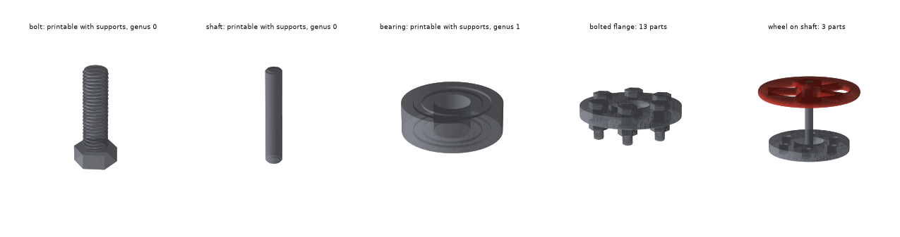

# Live text-to-CAD in the browser

The "Try it live" section of the website. Type "an M12 hex nut", get a checked, printable STL; then type "put a bolt
through every hole of the flange and a nut under each one" and get the assembly. Everything runs on the visitor's
device: no API key, no server.

```
prompt ──► open LLM (WebLLM, WebGPU) ──► {"family": "hex_nut", "params": {"thread": 12}}
                                              │  JSON, constrained by a schema
                                              ▼
           C++ engine (WebAssembly):  family ─► CSG parts ─► SDF ─► marching cubes ─► print checks
                                              │                                          │
                                              ▼                                          │ problems
                                    3D view + STL download ◄──────── ok ─────────────────┤
                                                                                         ▼
                                                                  feedback text ─► LLM (≤ 2 repairs)
```


## 1. The model only classifies and extracts numbers

Small models are good at "which part is this, and what numbers did the user give?" and bad at 3D layout. Our
first version let the model write free-form CSG parts. Every model from 0.5B to 7B produced valid shapes that
looked nothing like the request (0 to 2 of 8 prompts). So the model now answers with one of 15 **families**:

```json
{"name": "M12 hex nut", "family": "hex_nut", "params": {"thread": 12}}
```

Families: flange, pulley, knurled_knob, star_knob, hex_nut, hand_wheel, wall_hook, cable_organizer, spur_gear,
washer, standoff, l_bracket, and for assemblies bolt (with a real thread), shaft and bearing. `"custom"` with a
free-form part list is the fallback.

**Constrained decoding.** WebLLM (via XGrammar) masks every token that would break the JSON schema in
[`prompt.json`](prompt.json), so the output always parses. The schema is built to help a small model:

- one `anyOf` branch per family, holding only that family's params, so a gear can't get `base_length`;
- count params (`holes`, `teeth`, `spokes`, …) are **required** and listed first, so "three holes" isn't dropped;
- the guide lists synonyms ("coat hook" → wall_hook, "valve wheel" → hand_wheel).

The prompt is the system text plus the engine's own `spec_guide()` (families, params, ranges), followed by three
examples. It totals about 2,900 tokens, which fits WebLLM's 4,096-token context. Answers are capped at 500
tokens.

## 2. C++ turns a family into parts with real proportions

[`families.cpp`](../geometry_engine/src/families.cpp): each family clamps its params to a sane range, with a
note for each clamp, and writes CSG parts. Two examples:

- **Hex nut (ISO 4032):** across-flats $s$ comes from the ISO table ($s = 18$ mm for M12) and height is
  $m \approx 0.85\,d$. The engine builds a 6-sided prism and cuts a cylinder of diameter $d$.
- **Bolt (ISO 4017):** head across-flats from the same table, head height $k = 0.65\,d$, coarse pitch $P$ from
  ISO 261 ($P = 1.25$ mm for M8). The thread is its own SDF (section 3).
- **Spur gear (module $m$, teeth $z$):** pitch diameter $d = m z$, tip diameter $d + 2m$, root diameter
  $d - 2.5m$. Teeth are boxes of width $\pi m / 2$, repeated $z$ times around the axis.

## 3. Parts become a signed distance field

[`csg.cpp`](../geometry_engine/src/csg.cpp): each part is an exact SDF (box, cylinder, sphere, torus, capsule,
cone, n-gon prism). Rotation is $R = R_z R_y R_x$, applied as $R^{-1}$ to the query point. Parts combine in order:

$$d_{\text{add}} = \min(d, d_p) \qquad d_{\text{cut}} = \max(d, -d_p)$$

Fillets use the polynomial smooth minimum with blend radius $k$:

$$h = \operatorname{clamp}\!\left(\tfrac12 + \tfrac{d_p - d}{2k},\, 0,\, 1\right), \qquad
\operatorname{smin}(d, d_p) = d_p + (d - d_p)\,h - k\,h(1-h)$$

and $\operatorname{smax}(a,b) = -\operatorname{smin}(-a,-b)$ for blended cuts.

**Threads.** For a point at radius $r$, angle $\theta$ and height $y$, the helix phase
$u = y/P - \theta/2\pi$ picks where the point lies in the thread profile: a 60° trapezoid from the minor radius
(root) to the major radius $R$ (crest), depth $0.541P$. The distance is $\tfrac12\,(r - r_{\text{profile}}(u))$.
The flanks have slope $\tan 60^\circ$, so halving keeps it a lower bound of the true distance (safe for meshing
and collision tests). The ends are chamfered at 45°.

**Polar repeat** (bolt circles, teeth, spokes) evaluates the part once. The query angle is folded into the
sector that holds the part, $\theta' = ((\theta - \theta_0 + \tfrac{\pi}{n}) \bmod \tfrac{2\pi}{n}) - \tfrac{\pi}{n} + \theta_0$,
so 80 teeth cost the same as one.

## 4. Mesh and printability checks

- **Mesh:** the SDF is sampled on a $112^3$ grid with the boundary closed, then meshed with marching cubes, which
  makes it watertight by construction. QEM simplification reduces it to at most 60k triangles.
- **Topology:** shells come from connected components. Genus comes from Euler's formula,
  $g = 1 - \chi/2$ with $\chi = V - E + F$, per shell. A flange with 6 bolt holes and a bore has $g = 7$.
- **Wall thickness:** an exact 3D Euclidean distance transform (Felzenszwalb & Huttenlocher) on the voxel grid
  gives each surface point's local thickness. Walls under 1 mm are flagged.
- **Floating parts:** a shell whose lowest point is above the bed.
- **Overhangs:** faces whose downward normal satisfies $-n_z > \sin 45^\circ$ need support.

The verdict is "printable", "printable with supports" or "not printable". Each problem becomes a sentence that
names the part, e.g. `part 2 (sphere) floats in the air (lowest point y = 35)`. The sentence goes back to the
model as the next user message. On the 20 test prompts, Qwen3-4B never needed a repair. The loop exists for
custom parts and harder requests.

**WebAssembly:** the same C++ is compiled with Emscripten (`-O3`, `-fwasm-exceptions`, embind) to a 200 KB
`vibecad.wasm` ([`build.sh`](../geometry_engine/wasm/build.sh)). A build, mesh and check takes about 0.35 s in the
browser.

## 5. Assembly: the same model connects the parts



Every part has **ports**: named points with an outward direction. Families declare their own (`hole_3_top`,
`bore_bottom`, `top_end`, `under_head`), and every part also gets `top`, `bottom`, `left`, `right`, `front` and
`back` at the centres of its exact bounding box. The model gets the parts made so far and their ports
([`describe_parts`](../geometry_engine/src/assembly.cpp)), plus the instruction, and writes **mates**:

```json
{"name": "bolted flange", "mates": [
  {"part": "p2", "port": "under_head", "to": "p1", "to_port": "hole_1_top", "each": true},
  {"part": "p3", "port": "bore_top",   "to": "p1", "to_port": "hole_1_bottom", "each": true}]}
```

The schema is built at run time from the parts, so the model can only name real ids and ports.

[`assembly.cpp`](../geometry_engine/src/assembly.cpp) solves this without numerical optimization:

- **Placement.** A mate makes the two port points meet with the directions opposed (faces touching). With part
  port $(p_a, n_a)$ and target port $(p_b, n_b)$ already in world space, the rotation is
  $R = \mathrm{Rot}(n_b, \alpha)\,\mathrm{Align}(n_a \to -n_b)$. Align is the smallest rotation (Rodrigues),
  or a half turn when $n_a = n_b$, which is how a bolt turns head-up to go into a hole from above. The translation
  is $t = p_b + \text{offset}\cdot n_b - R\,p_a$, so a negative offset slides a part into its target.
- **Tree.** Parts that are never moved stay where they are (the base); the others are placed in mate order
  from there. A second mate for the same part must agree with the first.
- **`each`.** It copies the part for every port numbered like `to_port`: `hole_1_top` becomes
  `hole_1_top … hole_6_top`.
- **Collisions.** Where two parts' world boxes meet, a grid of up to $32^3$ points is tested with both distance
  fields: $d_A(R_A^{\top}(q - t_A)) < -\varepsilon$ and $d_B(\cdot) < -\varepsilon$, with $\varepsilon = 0.15$ mm. More than
  100 mm³ (or 5% of the smaller part) means the parts pass through each other, and that goes back to the model.
  Smaller amounts are tight fits and are reported to the user only.
- **Feedback** names the mate and lists the valid choices, e.g.
  `mate 1 (p2.head_bottom to p1.hole_1_top): p2 (M8 x 25 bolt) has no port "head_bottom". Its ports are: under_head, tip, head, …`.
  A mate that only repeats an `each` mate is dropped with a note.

Each part is meshed once and copies are transformed, so 13 parts (a flange, 6 bolts and 6 nuts) take about 0.5 s
in the browser. The STL download contains the whole assembly.

## 6. Choosing the model

[`eval_models.py`](eval_models.py) runs each model with the website's exact prompt, schema (XGrammar), token cap
and repair loop, and scores each answer with the same C++ engine.

- **Suggestions:** the prompts on the website. The part must match (exact hole, tooth and spoke counts;
  genus; size).
- **Held-out:** 10 prompts not shown on the website, with other wording and numbers ("Coat hook, 3 screw
  holes", "M8 nut"). A pass needs the right family and every stated number.
- **`EVAL_Q4=1`:** rounds the weights the way WebLLM's `q4f16_1` builds store them, before running. That is
  4-bit symmetric integers in groups of 32, $w' = s\cdot\operatorname{clamp}(\operatorname{round}(w/s), -7, 7)$
  with $s = \max|w_{\text{group}}|/7$ stored as fp16. So the 4-bit rows below are what the browser runs.

| Model | Weights | Suggestions | Held-out |
|---|---|---|---|
| **Qwen3-4B** | **4-bit (browser)** | **10/10** | **10/10** |
| Qwen3-4B | bf16 | 10/10 | 10/10 |
| Qwen3-1.7B | 4-bit (browser) | 9/10 | 6/10 |
| Qwen3-1.7B | bf16 | 7/10 | 8/10 |
| Qwen2.5-Coder-3B | 4-bit | 8/10 | 7/10 |
| Qwen2.5-Coder-1.5B | bf16 | 10/10 | 5/10 |
| Llama-3.2-1B | bf16 (unquantized) | 7/10 | 3/10 |
| Qwen2.5-Coder-0.5B | bf16 (unquantized) | 9/10 | 2/10 |
| Qwen3-0.6B | bf16 (unquantized) | 8/10 | 2/10 |

After adding bolt, shaft and bearing (12 suggestions, 12 held-out prompts), the browser models score:
Qwen3-4B 4-bit **12/12 and 11/12**, and Qwen3-1.7B 4-bit 12/12 and 9/12.

**Assembly** ([`eval_assembly.py`](eval_assembly.py)): 8 instructions over different parts. A pass means a valid
assembly, no collisions and the right connections (e.g. 13 parts for "a bolt through every hole and a nut
under each one").

| Model | Weights | Assemblies as instructed | First try |
|---|---|---|---|
| **Qwen3-4B** | **4-bit (browser)** | **6/8** | 6/8 |
| Qwen3-1.7B | 4-bit (browser) | 3/8 | 2/8 |

The two misses for Qwen3-4B: on the bracket it attached each bolt to both faces of the hole and didn't fix that
when told, and it put a nut under a standoff instead of on top. The checks catch the first (it is reported as
problems), not the second, which is a valid assembly of the wrong thing.

The unquantized models small enough for a browser learn the suggestions but fail on new wording. The site uses
**Qwen3-4B, 4-bit**: about a 2.3 GB download, cached by the browser, and 3.4 GB of GPU memory. Qwen3-1.7B is the
lighter option. Raw answers are in [`eval_results/`](eval_results/).

```bash
EVAL_OUT=out python src/live_cad/eval_models.py Qwen/Qwen3-4B
EVAL_Q4=1 EVAL_OUT=out python src/live_cad/eval_assembly.py Qwen/Qwen3-4B
EVAL_Q4=1 EVAL_OUT=out python src/live_cad/eval_models.py Qwen/Qwen3-4B Qwen/Qwen3-1.7B
```

## Files

| File | Role |
|---|---|
| [`prompt.json`](prompt.json) | system prompt, examples, JSON schema, website suggestions |
| [`web_models.json`](web_models.json) | WebLLM model IDs offered on the site (f16, with f32 fallback) |
| [`recorded.json`](recorded.json) | Qwen3-4B answers for the "no download" button (geometry still built live) |
| [`assembly_prompt.json`](assembly_prompt.json) | assembly system prompt, examples, demo parts and instructions |
| [`recorded_assembly.json`](recorded_assembly.json) | Qwen3-4B answers for the recorded assembly demo |
| [`eval_assembly.py`](eval_assembly.py) | assembly evaluation |
| [`../geometry_engine/src/assembly.cpp`](../geometry_engine/src/assembly.cpp) | ports, placement, copies, collisions, feedback |
| [`eval_models.py`](eval_models.py) | model evaluation |
| [`../geometry_engine/src/families.cpp`](../geometry_engine/src/families.cpp) | the 12 families |
| [`../geometry_engine/src/csg.cpp`](../geometry_engine/src/csg.cpp) | spec parser, SDF, build, feedback |
| [`../geometry_engine/wasm/`](../geometry_engine/wasm/) | WebAssembly bindings and build script |
| [`../../website/src/scripts/live-cad.ts`](../../website/src/scripts/live-cad.ts) | browser pipeline and repair loop |
| [`../../website/src/components/TryLive.astro`](../../website/src/components/TryLive.astro) | the website section |

## Limits

- **Browser support:** it needs WebGPU with at least 10 storage buffers per shader, which WebLLM's attention
  kernels use. Desktop Chrome and Edge usually have this; some browsers report 9 or fewer, and the page then says
  so. Without it, the recorded answers still run through the live C++ engine.
- **Coverage:** it works best for the 15 families. Custom parts from a 4B model are often wrong.
- **GPU memory:** the 4B model uses up to 3.4 GB of GPU memory, which can slow a laptop down. The page warns about
  this, has a "Free GPU memory" button, and unloads the model after 3 idle minutes (the weights stay cached).
- **Assembly scope:** mates are rigid and face-to-face. There are no gears meshing, no joints that move and no
  tolerance analysis.
- **Evaluation size:** 24 part prompts and 8 assembly instructions is a small evaluation. The checks catch broken and unprintable parts, not
  every wrong shape.
