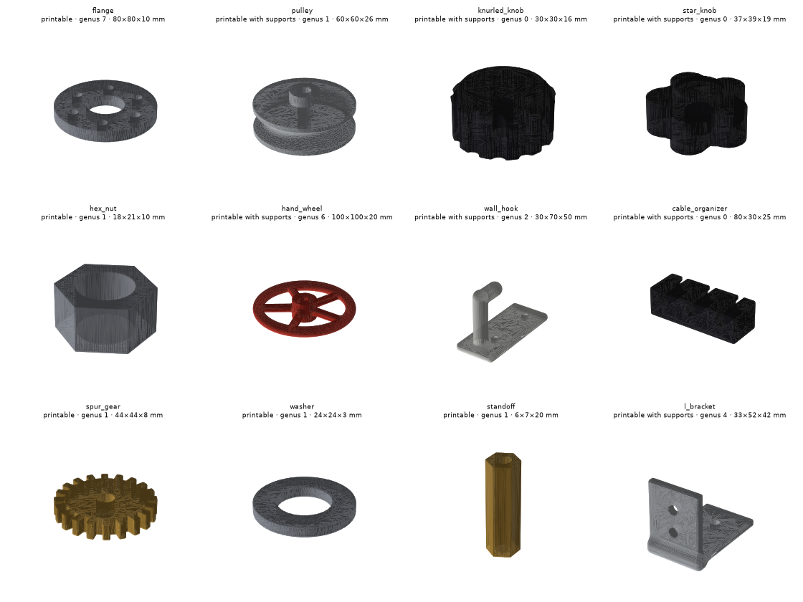

# Live text-to-CAD in the browser

The "Try it live" section of the website. Nothing runs on a server:

1. **An open LLM in the visitor's browser** ([WebLLM](https://github.com/mlc-ai/web-llm), WebGPU) reads the request,
   picks one of 12 **part families** and fills in the numbers (JSON, constrained by `prompt.json`'s schema).
2. **The C++ engine, compiled to WebAssembly** (`src/geometry_engine/wasm/`), expands the family into CSG parts
   with real proportions (ISO nut sizes, gear module, bolt circles), meshes it with marching cubes and checks it
   for 3D printing (watertight, floating parts, thin walls, overhangs) in about 0.3 s.
3. Problems go back to the model (up to 2 repairs). The visitor gets a 3D view and an STL.



Families: flange, pulley, knurled_knob, star_knob, hex_nut, hand_wheel, wall_hook, cable_organizer, spur_gear,
washer, standoff, l_bracket. Anything else falls back to `"custom"` (free-form CSG parts), which small models do poorly.

## Why families

The first version had the model write free-form CSG parts. Every model we tried (0.5B to 7B) produced valid
but wrong shapes: 0 to 2 of 8 prompts looked like the request. Small models are bad at 3D layout and good at
classification and extracting numbers, so the layout moved into C++ (`families.cpp`).

## Model choice

`eval_models.py` runs each model with the website's prompt, schema (XGrammar, the constraint engine inside
WebLLM), token limit and repair loop, and scores with the same C++ engine. `EVAL_Q4=1` rounds the weights the
way WebLLM's `q4f16_1` builds store them (4-bit, groups of 32), which is what the browser runs.

- *Suggestions*: the 10 prompts on the website; the part must match (exact hole/tooth/spoke counts, genus, size).
- *Held-out*: 10 prompts not on the website, other wording and numbers ("Coat hook, 3 screw holes", "M8 nut");
  a pass needs the right family and every stated number.

| Model | Weights | Suggestions | Held-out |
|---|---|---|---|
| **Qwen3-4B** | **4-bit (browser)** | **10/10** | **10/10** |
| Qwen3-4B | bf16 | 10/10 | 10/10 |
| Qwen3-1.7B | 4-bit (browser) | 9/10 | 6/10 |
| Qwen3-1.7B | bf16 | 7/10 | 8/10 |
| Qwen2.5-Coder-3B | 4-bit | 8/10 | 7/10 |
| Qwen2.5-Coder-1.5B | bf16 | 10/10 | 5/10 |
| Llama-3.2-1B | bf16 (unquantized) | 7/10 | 3/10 |
| Qwen2.5-Coder-0.5B | bf16 (unquantized) | 9/10 | 2/10 |
| Qwen3-0.6B | bf16 (unquantized) | 8/10 | 2/10 |

The unquantized models small enough for a browser (under 1B parameters) learn the suggestions but fail on new
wording. The site uses **Qwen3-4B, 4-bit** (about 2.3 GB download, 3.4 GB of GPU memory), with Qwen3-1.7B as a
lighter option. Raw results are in `eval_results/`.

The schema does part of the work: one branch per family with only its own parameters, count parameters
(holes, teeth, spokes) required, and family synonyms in the guide ("coat hook" is a wall_hook).

## Limits

- Needs WebGPU (desktop Chrome or Edge, recent Safari). Without it, the recorded answers (`recorded.json`, from
  Qwen3-4B 4-bit) still run through the live C++ engine.
- WebLLM builds these models with a 4096-token context. The prompt takes about 2,400 tokens, so answers are
  capped at 700 tokens and a repair sees only the latest attempt.
- 20 test prompts is a small evaluation. The checks catch broken and unprintable parts, not every wrong shape.

```bash
EVAL_OUT=out python src/live_cad/eval_models.py Qwen/Qwen3-4B
EVAL_Q4=1 EVAL_OUT=out python src/live_cad/eval_models.py Qwen/Qwen3-4B Qwen/Qwen3-1.7B
```
